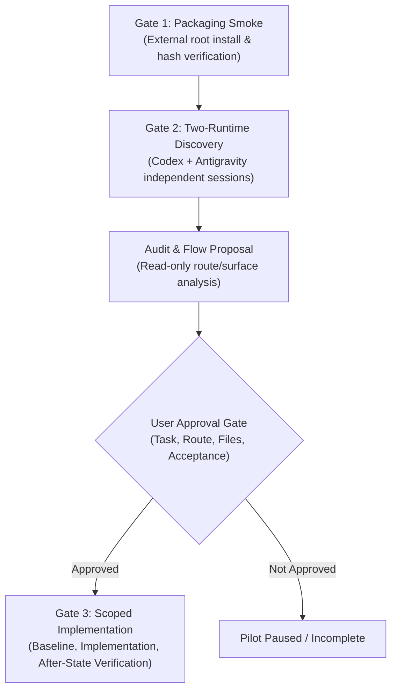

# Real-Project Pilot Runbook (TabDo)

[Installation Guide (EN)](README.md) · [Hướng dẫn cài đặt (VI)](README.vi.md) · [Skill Instructions](../../SKILL.md) · [Main README](../../README.md) · [P06 Distribution](../../docs/phases/p06-distribution-quality-scaling.md)

This runbook defines the preflight checks, gates, constraints, and evidence recording requirements for piloting `mobile-web-ui-ux-skill` on a real web application project.

## Candidate Project Context

- **Repository:** `https://github.com/fat2fast/TabDo`
- **Local Path:** `/home/phatp/work/tabdo`
- **Verified Baseline HEAD:** `2b06c112d8b06888086694ebd2aba7bf47646a05`
- **Worktree State:** Baseline check must preserve pre-existing untracked files (such as `plans/`).

> [!IMPORTANT]
> A candidate repository designation is **not** an authorization to modify application code. No UI or application changes may be made until the user explicitly reviews and approves the proposed task, route, allowed files, non-production login, commands, and acceptance criteria.

## Non-Negotiable Boundaries & Protected Contracts

The pilot must adhere to the following strict boundaries:
1. **Preserve Business Logic & Data Contracts:** Do not modify Supabase authentication, Row Level Security (RLS) policies, task reminder/extension flows, or recurrence semantics.
2. **Preserve Project Design Rules:** Maintain the project's visual identity and established UI patterns (such as existing `CustomDropdown` conventions).
3. **Strictly Prohibited Actions:** No database migrations, no database reset, no creation or mutation of production data, and no deployment commands.
4. **Process Lifecycle:** Reuse any already-running app dev server whenever possible. If an app server must be started, record the exact command, PID, and port, and stop it immediately upon test completion. Do not automatically install new npm dependencies.

## The Three Pilot Gates

### Gate 1: Safe Packaging Smoke
- Run dry-run and install outside the skill repository.
- Verify that only `SKILL.md`, `LICENSE`, and `references/**` are installed.
- Verify that every installed file matches the source SHA-256 hash.
- Verify link closure: all relative Markdown links in the installed package resolve internally.
- Record evidence in `docs/installation/installation-smoke.md`.

### Gate 2: Two-Runtime Activation Smoke
- Conduct two fresh, independent agent sessions:
  1. **OpenAI Codex**
  2. **Google Antigravity**
- For each runtime, verify that the agent identifies the installed project-local skill at `.agents/skills/mobile-web-ui-ux-skill/` and loads relevant references.
- Document observed tool reads and paths. A manual file read by the agent is recorded as a fallback, not an automated discovery PASS.
- Record exact runtime version, surface, and results in `docs/installation/installation-smoke.md`.

### Gate 3: Scoped Implementation Pilot
1. **Pre-Implementation Audit:** Inspect existing candidate routes (such as `/dashboard` or `/tasks/inbox` in `apps/web/src/app/App.tsx`).
2. **Proposal Submission:** Propose a single, tightly bounded mobile flow. Submit the exact task, route, absolute allowed file list, test commands, viewports, and expected acceptance criteria to the user for approval.
3. **Execution Freeze:**
   - Test commands: `pnpm --filter @tabdo/web test` and `pnpm --filter @tabdo/web typecheck` (note: typecheck verifies typing, not interactive behavior).
   - Expected exit codes: explicitly record expected exits for baseline and repaired after-state.
4. **Verification:**
   - Both mobile viewports and desktop regression tests must PASS.
   - Physical phone tests must be recorded as `NOT RUN` unless physically tested.
   - Record results in `docs/installation/pilot-results.md`.

## Failure and Rollback Protocol

If any verification step fails:
1. Revert only the authorized application file diff using git checkout against the recorded baseline SHA.
2. Retain all failure logs and evidence in the documentation; do not mark a failed gate as PASS.
3. Clean up any installed skill files or background processes created during the run.
